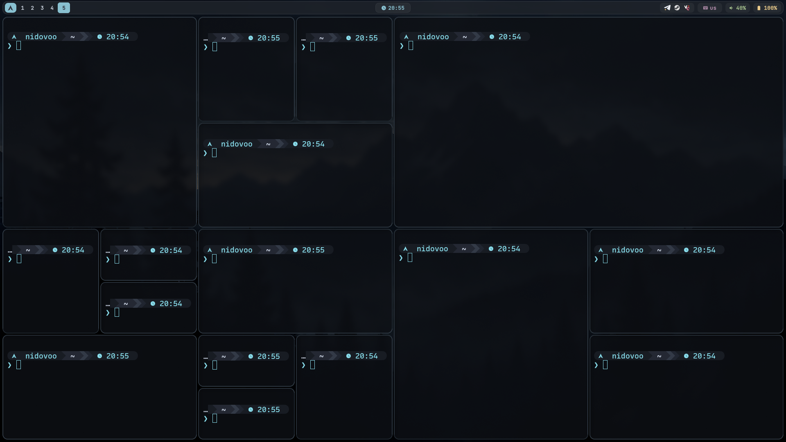
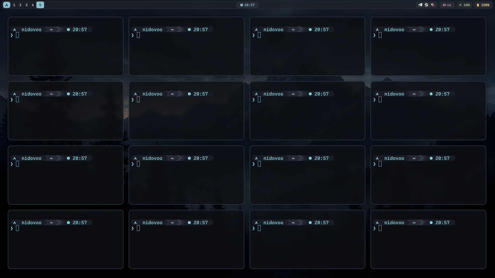
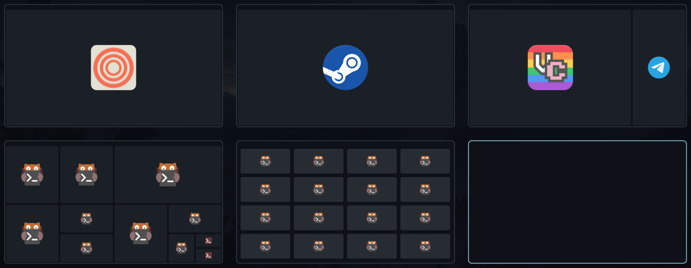

# swayflow

**Два инструмента для [Sway](https://swaywm.org/) в одном небольшом бинарнике на Rust.**

1. **`swayflow toggle`** — одной клавишей переводит все окна текущего workspace в плавающий режим и обратно в тайлинг. Окна при этом раскладываются аккуратно, без наложений; позиция и размер каждого окна запоминаются, так что при следующем включении плавающего режима всё встаёт на прежние места. Новые окна, открытые на таком workspace, тоже сразу становятся плавающими и сами находят себе свободное место.
2. **`swayflow overview`** — полноэкранный оверлей со схемой всех workspace текущего монитора. Каждый workspace показан карточкой с пропорциями экрана, а окна на ней нарисованы в точном масштабе (с реальной геометрией) и с иконками приложений. Это не скриншоты, а схематичные блоки: быстро, без задержек и без захвата содержимого окон. **Цвета оверлея настраиваются**: параметрами командной строки, конфигурационным файлом или одной командой из активной темы GTK.

Всё работает через стандартный IPC Sway, без перезагрузки конфига и без мерцания.

---

## Содержание

- [Как это выглядит](#как-это-выглядит)
- [Возможности](#возможности)
- [Быстрый старт](#быстрый-старт)
- [Требования](#требования)
- [Установка](#установка)
- [Настройка Sway](#настройка-sway)
- [Использование](#использование)
- [Настройка цветов обзора](#настройка-цветов-обзора)
- [Как это устроено](#как-это-устроено)
- [Ограничения и особенности](#ограничения-и-особенности)
- [Диагностика](#диагностика)
- [Разработка](#разработка)
- [Удаление](#удаление)
- [О проекте](#о-проекте)

---

## Как это выглядит

### Плавающий режим: до и после

| До: обычный тайлинг | После: `swayflow toggle` |
|:---:|:---:|
|  |  |

Одно нажатие клавиши раскладывает окна по свободным местам без наложений. Повторное нажатие возвращает их в тайлинг, а при следующем включении окна встают на запомненные места.

### Обзор workspace



Схема всех workspace монитора с точной геометрией окон и иконками приложений.

---

## Возможности

### Плавающий режим workspace (`toggle`)

- Один вызов переключает **весь workspace**: тайлинг → плавающие окна → тайлинг.
- **Раскладка без наложений.** Окна расставляются сеткой (ячейки подбираются под пропорции около 4:3) или, если места мало, каскадом.
- **Память о геометрии.** При возврате в тайлинг позиция и размер каждого окна сохраняются. При следующем включении плавающего режима окно возвращается ровно туда, где вы его оставили (с пересчётом, если разрешение workspace изменилось).
- **«Липкий» режим workspace.** Пока режим включён, любое новое окно на этом workspace автоматически становится плавающим и получает свободное место; окна, которые вы ещё не двигали руками, при этом перераскладываются, чтобы всем хватило места.
- **Аккуратный возврат в тайлинг.** Окна возвращаются в исходном порядке, а направление разделения (`split h` / `split v`) выбирается по форме будущего окна, а не «в одну длинную строку». Результат похож на раскладку, которую даёт autotiling/dwindle.
- **Учёт зазоров (gaps).** Отступы между окнами и от краёв определяются автоматически по текущему тайлингу.
- Работает на пустом workspace (включает «липкий» режим для будущих окон) и на workspace с одним окном.

### Обзор workspace (`overview`)

- Показывает **все workspace монитора, на котором находится фокус**.
- Карточки имеют те же пропорции, что и экран, поэтому окна на миниатюрах **повторяют реальную геометрию** — и тайловые, и плавающие (плавающие нарисованы чуть светлее).
- На блоках окон — **иконки приложений** (по `.desktop`-файлам и теме иконок), с поддержкой HiDPI.
- Окно в фокусе подсвечено, выбранный workspace обведён акцентной рамкой.
- **Цвета настраиваются** тремя способами: [параметры командной строки](#способ-1-параметры-командной-строки), [конфигурационный файл](#способ-2-конфигурационный-файл) или [цвета активной темы GTK](#способ-3-цвета-из-gtk-темы). Способы можно сочетать.
- Все данные берутся **одним запросом** `get_tree`, workspace при открытии обзора не переключаются.
- Управление с клавиатуры и мышью (см. [таблицу клавиш](#overview-управление)). Повторный вызов команды закрывает оверлей.

### Фоновый демон (`daemon`)

Небольшой процесс, который слушает события Sway и обслуживает «липкий» режим. Запускается **автоматически** при первом `toggle`, отдельно его настраивать не нужно. Одновременно работает только один экземпляр.

---

## Быстрый старт

```bash
# 1. Зависимости (пример для Arch)
sudo pacman -S --needed rust pkgconf gtk3 gtk-layer-shell

# 2. Сборка и установка
cargo build --release
install -Dm755 target/release/swayflow ~/.local/bin/swayflow

# 3. Две строки в ~/.config/sway/config
#    bindsym $mod+f   exec swayflow toggle
#    bindsym $mod+Tab exec swayflow overview

# 4. Применить конфиг
swaymsg reload
```

---

## Требования

| Что | Зачем |
|---|---|
| **Sway** (Wayland) | Всё управление идёт через Sway IPC. Форки с совместимым IPC (например, SwayFX) тоже должны работать |
| **Rust 1.77+**, `pkg-config` | Сборка |
| **GTK 3** и **gtk-layer-shell 0.6+** | Только для `overview`. Оверлей рисуется через протокол `wlr-layer-shell`, который Sway поддерживает |

Если `overview` не нужен, GTK не требуется: см. [сборку без Overview](#сборка).

---

## Установка

### Зависимости

**Arch / Manjaro**
```bash
sudo pacman -S --needed rust pkgconf gtk3 gtk-layer-shell
```

**Debian 12+ / Ubuntu 22.04+**
```bash
sudo apt install cargo pkg-config libgtk-3-dev libgtk-layer-shell-dev
```

**Fedora**
```bash
sudo dnf install cargo pkgconf-pkg-config gtk3-devel gtk-layer-shell-devel
```

Если `cargo --version` показывает версию ниже 1.77, поставьте актуальный Rust через rustup:
```bash
curl --proto '=https' --tlsv1.2 -sSf https://sh.rustup.rs | sh
```

### Сборка

```bash
cd swayflow
cargo build --release
```

Бинарник появится в `target/release/swayflow`.

Сборка **без Overview** и без пакетов GTK (останутся `toggle` и `daemon`):

```bash
cargo build --release --no-default-features
```

В таком бинарнике `swayflow overview` завершится с сообщением о том, что программа собрана без функции `overview`.

> Структуру папки менять нельзя: Cargo ожидает `Cargo.toml` в корне и исходники в `src/`.

### Установка бинарника

```bash
install -Dm755 target/release/swayflow ~/.local/bin/swayflow
```

Убедитесь, что `~/.local/bin` есть в `PATH` для сессии Sway (проверьте `~/.profile` или `environment.d`, а не только `~/.bashrc`). Либо установите в `/usr/local/bin` через `sudo install`.

---

## Настройка Sway

В `~/.config/sway/config`:

```
bindsym $mod+f   exec swayflow toggle
bindsym $mod+Tab exec swayflow overview
```

Затем:

```bash
swaymsg reload
```

Демон отдельно запускать не нужно: `toggle` стартует его сам. Клавиши — только пример, назначьте любые.

---

## Использование

```text
swayflow toggle     переключить текущий workspace: тайлинг <-> плавающие окна
swayflow overview   открыть (или закрыть) обзор workspace; параметры цвета: см. ниже
swayflow daemon     цикл событий для «липкого» режима (запускается из toggle)
```

Без аргументов или с неизвестной командой программа печатает подсказку и завершается с кодом 2. Справка по параметрам обзора: `swayflow overview --help`.

### `toggle`

**Первое нажатие (тайлинг → плавающий режим):**

1. Все тайловые окна workspace (кроме полноэкранных) переводятся в плавающий режим.
2. Если для окна уже есть сохранённая геометрия, оно возвращается на прежнее место и в прежнем размере.
3. Остальные окна получают места автоматически: сеткой, а если часть пространства уже занята (окнами, которые уже были плавающими, или восстановленными окнами) — в свободные промежутки.
4. Фокус возвращается на то окно, которое было в фокусе.
5. Для workspace включается «липкий» режим и запускается демон (если ещё не запущен).

**Второе нажатие (плавающий режим → тайлинг):**

1. Геометрия каждого окна, которым управлял swayflow, записывается в состояние.
2. Окна возвращаются в тайлинг в том порядке, в котором они были в тайлинге до включения плавающего режима.
3. Для каждого окна направление разделения выбирается по форме: если окно получается выше, чем шире, делается `split v`, иначе `split h`.
4. Фокус возвращается на прежнее окно, «липкий» режим workspace выключается.

Окна, которые были плавающими ещё до первого `toggle`, остаются плавающими и после возврата в тайлинг. swayflow возвращает в тайлинг только те окна, которые сам перевёл в плавающий режим.

### Новые окна в «липком» режиме

Пока workspace в плавающем режиме, демон реагирует на события Sway:

- **Новое окно** (или окно, перенесённое на этот workspace) становится плавающим.
- Окна, которые всё ещё стоят там, куда их поставила автораскладка (допуск 6 px), считаются «нетронутыми» и **перераскладываются вместе с новым окном**.
- Окна, которые вы двигали или меняли вручную, считаются **препятствиями**: их позиция не меняется, новые окна ищут место вокруг.
- Если workspace опустел и Sway его удалил, его состояние забывается.

### `overview`: управление

| Действие | Клавиши / мышь |
|---|---|
| Выбрать следующий / предыдущий workspace | `→` `l` `Tab` / `←` `h` `Shift+Tab` |
| Выбрать workspace строкой выше / ниже | `↑` `k` / `↓` `j` |
| Перейти на выбранный workspace | `Enter`, `Space` |
| Перейти на workspace с номером 0–9 | цифры `0`–`9` |
| Закрыть без действий | `Esc`, `q` |
| Подсветить карточку | навести курсор |
| Сфокусировать окно | левый клик по окну на миниатюре (Sway сам перейдёт на его workspace) |
| Перейти на workspace | левый клик по свободному месту внутри карточки |
| Закрыть | левый клик мимо карточек, либо любая другая кнопка мыши |

При открытии выбран текущий workspace. Выбор не «зацикливается» на краях. Если выбран workspace, который уже показан, оверлей просто закрывается. Workspace с нечисловыми именами не выбираются цифрами, только стрелками или мышью.

Повторный запуск `swayflow overview`, пока обзор открыт, закрывает его: удобно использовать одну клавишу и для открытия, и для закрытия.

Коды возврата: `0` — успех, `1` — не удалось собрать данные (нет сфокусированного монитора или workspace), `2` — неверное использование (неизвестный параметр, неверный цвет, нечитаемый файл из `--config`).

---

## Настройка цветов обзора

Оверлей состоит из шести цветов («ролей»). Каждую роль можно переопределить, остальные останутся прежними.

| Роль | Что окрашивает | По умолчанию |
|---|---|---|
| `background` | затемнение всего экрана позади карточек | `#0b0e13`, непрозрачность 80% |
| `card` | карточка workspace | `#0f1217`, непрозрачность 96% |
| `border` | рамка карточки | `#2e3842` |
| `accent` | рамка выбранной карточки и подсветка окна в фокусе | `#88c0d0` |
| `window` | тайловое окно | `#1b2027` |
| `floating` | плавающее окно (по умолчанию чуть светлее тайлового) | `#262c32` |

### Формат цвета

- имя CSS: `steelblue`, `white`, `orange`, `transparent` и другие распространённые названия;
- `#rgb`, `#rgba`, `#rrggbb`, `#rrggbbaa` (символ `#` можно не писать: `88c0d0`);
- `rgb(r, g, b)` и `rgba(r, g, b, a)`: каналы 0–255 или проценты, альфа 0–1 или процент. Допустима и запись `rgb(0 128 255 / 50%)`.

Цвет `background` без альфа-канала получает непрозрачность 80%, потому что это затемнение, а не сплошная заливка. Чтобы задать другую, укажите альфу: `rgba(0, 0, 0, 0.6)` или `#00000099`. Остальные роли без альфы непрозрачны.

### Способ 1. Параметры командной строки

```bash
swayflow overview --accent orange
swayflow overview --background '#1e1e2e' --accent '#cba6f7'
swayflow overview --background 'rgba(0, 0, 0, 0.6)' --window gray --floating darkgray
```

Параметры: `--background`, `--card`, `--border`, `--accent`, `--window`, `--floating`. Работают обе записи: `--accent blue` и `--accent=blue`. В конфиге Sway:

```
bindsym $mod+Tab exec swayflow overview --accent '#cba6f7'
```

> Значения с `#` или скобками берите в кавычки: в оболочке `#` в начале слова начинает комментарий. Или пишите цвет без `#`: `--accent cba6f7`.

### Способ 2. Конфигурационный файл

Файл `~/.config/swayflow/overview.conf` (точнее, `$XDG_CONFIG_HOME/swayflow/overview.conf`) читается автоматически, если существует. Другой файл: `swayflow overview --config /путь/к/файлу`; не читать файл вообще: `--no-config`.

```ini
# ~/.config/swayflow/overview.conf
# Строки «ключ = значение». Комментарии: строки, начинающиеся с # или ;,
# а также хвост строки после пробела и # или ;.

# theme = gtk              # базовые цвета из темы GTK (по умолчанию: default)

background = #0b0e13       # затемнение экрана (без альфы: 80% непрозрачности)
card       = #0f1217
border     = #2e3842
accent     = #88c0d0
window     = #1b2027
floating   = #262c32
```

Все ключи необязательны: указывайте только то, что хотите изменить. Значения можно брать в кавычки. Ошибки в файле не мешают запуску: строку с неверным ключом или цветом swayflow пропускает и печатает предупреждение с номером строки в stderr. Отсутствие файла по умолчанию ошибкой не считается, а вот файл, указанный в `--config`, должен существовать.

### Способ 3. Цвета из GTK-темы

```bash
swayflow overview --theme gtk
```

То же самое задаёт строка `theme = gtk` в конфигурационном файле. Из активной темы GTK 3 берутся:

| Роль | Откуда |
|---|---|
| `background` | `theme_bg_color` |
| `accent` | `theme_selected_bg_color` |
| `card`, `border`, `window`, `floating` | вычисляются из фона и цвета текста темы (`theme_fg_color`) |

Для тем в стиле libadwaita проверяются и запасные имена (`window_bg_color`, `accent_bg_color` и т. п.). Оверлей работает на GTK 3, поэтому берётся именно тема GTK 3, настроенная в вашей сессии. Если тема не определяет нужные цвета, swayflow напишет об этом в stderr и использует встроенную палитру. Вернуть встроенную палитру вместо `theme = gtk` из конфига можно параметром `--theme default`.

### Приоритет

Цвета берутся из четырёх источников, более поздний перекрывает более ранний:

1. встроенная палитра;
2. тема GTK (`--theme gtk` или `theme = gtk`);
3. конфигурационный файл;
4. параметры командной строки.

Перекрывается каждая роль отдельно: например, `--theme gtk` вместе с `--accent red` даёт цвета темы, но красный акцент.

### Достаточно одного цвета

Если источник задаёт `background`, а `card`, `border`, `window` и `floating` не указаны, они вычисляются автоматически: фон смешивается с белым (для тёмного фона), с чёрным (для светлого) или с цветом текста темы GTK. Поэтому один параметр перекрашивает всё оформление, в том числе на светлом фоне:

```bash
swayflow overview --background 'rgba(235, 235, 240, 0.85)' --accent '#3b6fd8'
```

Явно заданные роли никогда не заменяются вычисленными. Единственный нюанс: если `--background` указан в командной строке, оттенки, заданные в конфиге, заменятся производными от нового фона. Чтобы оставить их, повторите их в командной строке.

---

## Как это устроено

### Модули

| Файл | Назначение |
|---|---|
| `main.rs` | разбор аргументов, коды возврата |
| `commands.rs` | команды `toggle` и `daemon`, обработка событий Sway |
| `floating.rs` | переходы тайлинг → плавающий режим и обратно, раскладка новых окон, проверка результата, сброс состояния пустых workspace |
| `geom.rs` | чистая геометрия: сетка, каскад, поиск свободного места, восстановление геометрии, определение зазоров |
| `sim.rs` | симуляция тайлингового дерева Sway для выбора `split h` / `split v` |
| `tree.rs` | типизированное представление ответа `get_tree` и обход дерева |
| `ipc.rs` | минимальный синхронный клиент протокола i3/Sway IPC |
| `state.rs` | состояние в JSON и глобальная блокировка |
| `paths.rs` | расположение файлов состояния, блокировок и pid, а также конфигурационного файла обзора |
| `sys.rs` | тонкие обёртки над POSIX (`flock`, `kill`, `setsid`, `getuid`); весь `unsafe` собран только здесь |
| `error.rs` | единый тип ошибок |
| `overview/mod.rs` | команда `overview`: сбор данных, расчёт раскладки карточек, pid-файл |
| `overview/color.rs` | тип цвета и разбор текстовых записей (имена, `#hex`, `rgb()` / `rgba()`), смешивание цветов; не зависит от GTK |
| `overview/theme.rs` | роли цветов, слои палитры и их приоритет, параметры командной строки, конфигурационный файл; не зависит от GTK |
| `overview/ui.rs` | GTK 3 + layer-shell, отрисовка через cairo, поиск иконок, чтение цветов темы GTK |

### Как окна попадают на свои места

Все команды для окон собираются в одну цепочку (через `;`) и отправляются в Sway одним запросом, поэтому раскладка применяется без мерцания.

**Размеры учитывают рамки.** Целевой прямоугольник задаёт *внешние* границы окна (вместе с рамкой и заголовком). Команда `resize` получает размер за вычетом рамок, поэтому окна не «съезжают» и не налезают друг на друга.

**Проверка после раскладки.** После применения команд swayflow заново читает дерево и поправляет окна, которые Sway поставил не точно (например, из-за минимальных размеров). Поправка применяется, если отклонение не превышает 48 px.

**Отступы.** По умолчанию внешний отступ 24 px и промежуток между окнами 16 px. Если в тайлинге обнаружены зазоры Sway (`gaps`; ближайшее ненулевое расстояние от окна до края workspace, не больше 64 px), оба значения заменяются на найденный зазор (но не меньше 4 px), и он запоминается.

**Сетка.** Для `n` окон перебирается число колонок; выбирается вариант, в котором ячейки получаются самыми крупными и ближе всего к пропорции 4:3. Неполный последний ряд центрируется. Одно окно занимает 72% рабочей области по центру. Если ячейки получаются меньше 320×220 px, используется каскад.

**Поиск свободного места.** Когда часть пространства уже занята, область сканируется слева направо и сверху вниз с шагом 24 px. Размер окна пробуется в 100%, 85%, 70% и 55% от расчётного (но не меньше 320×220). Если места нет вовсе, окно ставится каскадом (диагональный сдвиг на 40 px).

**Восстановление геометрии.** Сохранённый прямоугольник хранится относительно workspace вместе с размером workspace на тот момент. Если размер изменился (другое разрешение, другой монитор), позиция и размер пропорционально пересчитываются. Не менее 80 px окна всегда остаются на экране.

### Возврат в тайлинг

Чтобы выбрать `split` для каждого окна, `sim.rs` строит в памяти копию тайлингового дерева workspace и по очереди «вставляет» в неё окна так же, как это сделал бы Sway: рядом с листом, который был в фокусе последним. После каждой вставки симуляция пересчитывает размеры и определяет, станет ли окно выше или шире. Если выше, нужен `split v`, иначе `split h`. Так формируется раскладка в стиле dwindle/spiral, как у autotiling, а не одна длинная строка.

### Состояние и файлы

Всё хранится в `$XDG_RUNTIME_DIR`. Если переменная не задана, используется `/tmp`, и к именам файлов добавляется `-<uid>` (например, `/tmp/swayflow-1000.json`).

| Файл | Назначение |
|---|---|
| `swayflow.json` | основное состояние |
| `swayflow.json.tmp` | временный файл для атомарной записи (запись и переименование) |
| `swayflow.lock` | глобальная блокировка на время чтения, изменения и записи состояния |
| `swayflow-daemon.lock` | гарантирует единственный экземпляр демона |
| `swayflow-overview.pid` | pid открытого обзора (нужен, чтобы повторный вызов его закрывал) |

Конфигурационный файл обзора (`~/.config/swayflow/overview.conf`) лежит отдельно, в каталоге конфигурации пользователя, и программой никогда не изменяется.

Формат `swayflow.json`:

```json
{
  "sock": "/run/user/1000/sway-ipc.1000.1234.sock",
  "gap": 10,
  "geom": {
    "42": { "r": [120, 80, 900, 600], "a": [1920, 1080] }
  },
  "ws": {
    "1": {
      "floating": true,
      "managed": [42, 43],
      "order": [43, 42],
      "auto": { "43": [24, 24, 936, 516] }
    }
  }
}
```

| Поле | Смысл |
|---|---|
| `sock` | сокет Sway, для которого записано состояние; файл от другого экземпляра Sway игнорируется |
| `gap` | запомненный зазор Sway |
| `geom` | по id окна: `r` — прямоугольник `[x, y, ширина, высота]` относительно workspace, `a` — размер workspace в момент сохранения |
| `ws` | по имени workspace: `floating` — включён ли плавающий режим; `managed` — окна под управлением swayflow; `order` — порядок окон в тайлинге до включения режима; `auto` — прямоугольники, назначенные последней автораскладкой (по ним определяется, трогал ли окно пользователь) |

При каждом `toggle` из состояния удаляются записи о закрытых окнах и несуществующих workspace. Повреждённая запись о геометрии одного окна игнорируется отдельно и не ломает остальное.

### Надёжность

- Любое чтение-изменение-запись состояния проходит под эксклюзивным `flock`, а сам файл пишется атомарно, поэтому `toggle` и демон не мешают друг другу.
- Демон использует два соединения с IPC: одно для подписки на события (`window`, `workspace`), второе для команд.
- Демон тихо завершается, когда Sway закрывается. Ошибки обработки отдельных событий выводятся в stderr и не останавливают цикл.
- Размер входящего сообщения IPC ограничен 64 МиБ, чтобы повреждённый заголовок не приводил к огромным выделениям памяти.
- Обзор завершается корректно по `SIGTERM` и `SIGINT`.

---

## Ограничения и особенности

- **Только Sway / Wayland.** Для `overview` нужен композитор с поддержкой `wlr-layer-shell`.
- **Обзор показывает workspace одного монитора** — того, где сейчас фокус. И он не делает скриншотов: показывает схему окон и иконки.
- **Возврат в тайлинг не воссоздаёт прежнее дерево в точности.** Сохраняются порядок окон и разумное направление разделений, но группы `tabbed` / `stacked` и пользовательские пропорции разделений не восстанавливаются.
- **Полноэкранные окна** не трогаются ни при переключении, ни при автораскладке.
- **Все окна становятся отдельными плавающими окнами**, в том числе те, что находились в `tabbed` / `stacked` контейнере.
- **Память о геометрии привязана к жизни окна и сессии.** Состояние лежит в `$XDG_RUNTIME_DIR`, поэтому сбрасывается при выходе из сессии или перезагрузке; для другого экземпляра Sway оно тоже не применяется.
- **Настраиваются только цвета обзора.** Пороги раскладки плавающих окон (минимальный размер окна 320×220, шаг сканирования 24 px, шаг каскада 40 px, допуск 6 px и т. д.) заданы константами в начале `src/geom.rs`; ни параметров, ни конфигурационного файла для них нет.
- **Цвета из темы GTK ограничены тремя значениями** (фон, текст, акцент); остальные оттенки вычисляются. Тема GTK 4 в обзоре не используется: оверлей работает на GTK 3.
- Иконка для окна ищется по `app_id`, а для XWayland-окон по классу окна. Если ничего не найдено, используется общая иконка исполняемого файла; для слишком маленьких блоков (меньше 28 px по короткой стороне) иконка не рисуется.

---

## Диагностика

**Overview открывается обычным окном, а не оверлеем.** Библиотека `libgtk-layer-shell` должна загружаться раньше `libwayland-client`. Запустите с предзагрузкой:

```bash
LD_PRELOAD=/usr/lib/libgtk-layer-shell.so swayflow overview
```

Путь может быть `/usr/lib64/...` или `/usr/lib/x86_64-linux-gnu/...`. Можно прописать его прямо в `bindsym`:

```
bindsym $mod+Tab exec env LD_PRELOAD=/usr/lib/libgtk-layer-shell.so swayflow overview
```

**Ошибка «compositor does not support wlr-layer-shell».** Композитор не поддерживает нужный протокол либо программа запущена не из сессии Wayland.

**Ошибка «missing dependency (gtk3, gtk-layer-shell) or no display».** Не установлены пакеты GTK или нет доступа к дисплею.

**Цвет не применяется или при запуске появляются предупреждения.** Предупреждения о строках конфига печатаются в stderr, а запуск из `bindsym` их скрывает. Запустите команду в терминале: `swayflow overview` покажет номер строки и причину. Если `--accent #88c0d0` игнорируется или даёт ошибку, значение с `#` нужно взять в кавычки: `--accent '#88c0d0'`.

**«unknown colour» или «invalid hex colour».** Цвет записан неверно. Допустимы имена CSS, `#rgb`, `#rrggbb`, `#rrggbbaa`, `rgb(...)` и `rgba(...)`.

**«the GTK theme does not define the expected colours».** Активная тема GTK 3 не определяет ни `theme_bg_color`, ни акцентные цвета. Используется встроенная палитра; задайте цвета вручную в конфиге или параметрами.

**Не находится `sway --get-socketpath`.** Запускайте из сессии Sway или задайте переменную `SWAYSOCK`.

**Новые окна не становятся плавающими.** Ошибки демона уходят в `/dev/null`, потому что это фоновый процесс. Остановите его и запустите вручную, чтобы увидеть сообщения:

```bash
pkill -f 'swayflow daemon'
swayflow daemon
```

**Ошибка сборки в `overview/ui.rs`.** Эта часть использует gtk-rs 0.18 (GTK 3); версии зависимостей зафиксированы в `Cargo.lock`. Пока проблема не решена, можно собрать без Overview: `cargo build --release --no-default-features`.

---

## Разработка

```bash
cargo build --release                          # полная сборка
cargo build --release --no-default-features    # без GTK, только toggle и daemon
cargo test                                     # модульные тесты
```

Опциональная зависимость `overview` включена по умолчанию (`gtk 0.18`, `gtk-layer-shell 0.8`). Для релизной сборки включены `lto`, `codegen-units = 1` и `strip`.

Тесты покрывают всю логику, не требующую запущенного Sway: геометрию (сетка, каскад, поиск свободного места, восстановление, определение зазора), разбор и обход дерева, формат файла состояния, симуляцию `split`, построение данных и раскладки карточек обзора, а также разбор цветов, параметров командной строки и конфигурационного файла с приоритетом источников.

---

## Удаление

```bash
pkill -f 'swayflow daemon'
rm ~/.local/bin/swayflow
rm -f "$XDG_RUNTIME_DIR"/swayflow*
```

Не забудьте убрать строки `bindsym` из конфига Sway.

---

## О проекте

Программа написана ИИ-ассистентом Claude (Anthropic) на Rust.
